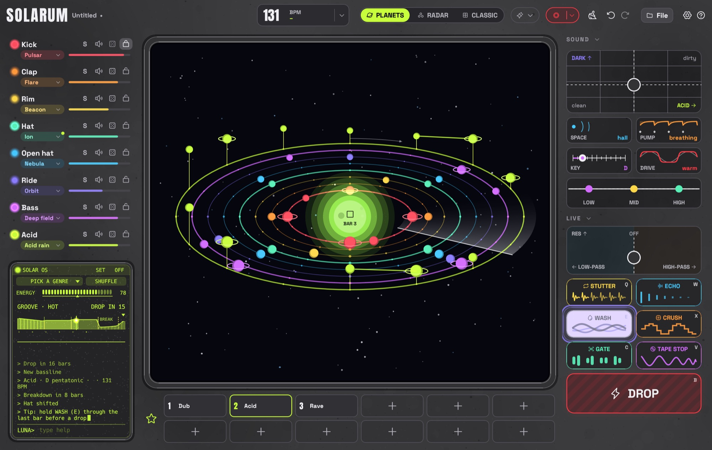

<p align="center">
  
</p>

<h1 align="center">SOLARUM</h1>

<p align="center">
  <b>Techno from another planet. Easy to use, beautiful to look at, free for Mac and Windows.</b><br>
  Made for everyone: kids, beginners and people who have never touched music software.<br>
  Paint a beat onto an empty solar system, or let Solari, the little robot, play a whole set for you.
</p>

<p align="center">
  <a href="https://github.com/tj537/solarum/releases/latest"></a>
  
  
  
  <a href="LICENSE"></a>
</p>

<p align="center">
  <a href="https://github.com/tj537/solarum/releases/latest/download/Solarum-macos-universal.zip"></a>
  &nbsp;
  <a href="https://github.com/tj537/solarum/releases/latest/download/Solarum-windows-x64.zip"></a>
</p>

<p align="center">
  🪐 <b><a href="https://tj537.github.io/solarum/">Visit the website: tj537.github.io/solarum</a></b>
</p>

<p align="center">
  <a href="#install">Install</a> ·
  <a href="#what-it-does">What it does</a> ·
  <a href="#keys">Keys</a> ·
  <a href="#midi">MIDI</a> ·
  <a href="#build-it-yourself">Build it</a> ·
  <a href="#help-make-solarum">Help</a>
</p>



Solarum is a techno drum machine written in Rust. Your groove is a little solar system: every track is an orbit round the sun, every step a planet, and a beam of light sweeps round once a bar. Kick, clap, hats, bass and a 303-style synth are all synthesized live – no samples, no plug-ins, no account, no tracking. It's free, open source and only a few megabytes for macOS and Windows.

## Why Solarum

| | |
|---|---|
| **Easy to use** | No timeline, no mixer, no menus full of words you don't know. Click a planet and it plays. Drag it up and it sings higher. |
| **Beautiful** | Your beat is a little solar system turning in deep space. Every sound has its own colour, and every beat lights up as the beam sweeps past. |
| **For everyone** | Kids, beginners and people with no music or tech experience make something that sounds good from the first click. If you do know your way around, everything you'd expect is there too. |
| **Plays by itself** | Switch on Solari, pick a vibe, and it builds a whole set on its own: grooves that change, breakdowns, build-ups and drops. Jump in whenever you like. |

> [!NOTE]
> **Solarum is still young and changing fast**, so things will move around and some will break. Feedback, criticism, ideas and help are more than welcome: [report a bug](https://github.com/tj537/solarum/issues/new?template=bug_report.yml), [share an idea](https://github.com/tj537/solarum/issues/new?template=feature_request.yml) or send a pull request. See [Help make Solarum](#help-make-solarum).

### No music theory needed

- **Grooves that already work.** Pick a vibe and Solarum rolls a pattern that follows the genre's rules: four on the floor, claps on 2 and 4, a bassline that dodges the kick, bass and synth on the same chord. It sounds like techno from the first second.
- **Words instead of theory.** You never pick a scale or a chord progression – you pick a mood. The tempo box at the top shows every mood as a tile with its four chords: *Dark, Hypnotic, Deep, Sad, Euphoric, Dreamy, Epic, Sunny, Mysterious*. Leave it on *Auto* and every shuffle picks one that suits the vibe. Solarum starts on *Neutral* (plain minor, no chord changes). Each mood brings its own chords, so the bars move instead of repeating, and a mood you pick stays through shuffles and the auto mode. Tempo and swing come with the vibe – or pick *Custom* and start from an empty pattern.
- **Nothing goes off-beat.** Favorites, drops and song parts wait for the next bar, and every loop fits the bar.
- **One fader from intro to drop.** The energy fader is the arrangement, not the volume: low is a break, the middle is the groove, and at the top everything plays. It starts full. DROP does the drop.
- **A song without a timeline.** Save your favorite grooves, pick AUTO SONG from the arrow next to the record button, and Solarum plays a whole track from them: intro, groove, break, build-up, drop, outro.
- **Nothing to break.** <kbd>⌘</kbd>/<kbd>Ctrl</kbd>+<kbd>Z</kbd> undoes every change, even a shuffle or the broom (which clears the sky and resets every setting). The tempo box's menu has a metronome that clicks on every beat while you build. Your work is saved automatically.

**If you do know what you're doing,** you still get per-step accents, slides and probability, tune and decay per track, a master EQ, MIDI in and WAV recording.

### By hand means by hand

With SOLAR OS off, Solarum plays exactly what you programmed and changes nothing by itself: no ghost hats, no thinned-out percussion, no clap roll before a favorite. A new synth sound or mood keeps your bass and synth lines – a mood only moves their notes into its scale. Only the controls you touch (energy, DROP, the effects) change what plays.

And everything SOLAR OS does, you can do yourself with a right-click:

- **a track's name** – new rhythm, new notes on the same rhythm (bass, synth), add or remove ghost notes, thin out (plain steps play half the time), clear;
- **a step** – ghost (soft), accent, how often it plays, the note;
- **DROP** – a fill: clap roll, gap, falling toms, open hats, clap into the echo;
- **a favorite** – switch with a clap roll.

While SOLAR OS plays, *Settings → SOLAR OS* can switch off the ghost hats and thinning.

## What it does

### Grooves and sounds

- **Ten vibes:** Dub, Minimal, Melodic, Hypnotic, Electro, Peak time, Acid, Rave, Industrial and Hard, each with its own tempo, sounds and pattern rules. Pick one in the auto mode's terminal, then press **SHUFFLE** (<kbd>Enter</kbd>) for a new groove – always clearly different from the last one, sometimes busier, sometimes sparser. **Custom** starts from an empty pattern for you to paint.
- **Eight tracks, 51 sounds, named for space:** seven kicks (Pulsar, Gravity, Impact, Abyss, Meteor, Core, Supernova), claps and snares (Flare, Comet, Solar wind, Spark, Static, Old signal), percussion (Ping, Beacon, Probe, Crater, Sonar, Moon drum, Laser), closed hats (Stardust, Ion, Asteroids, Quartz, Satellite, Frost), open hats (Nebula, Aurora, Plasma, Tail, Ring), rides (Orbit, Halo, Eclipse, Big Bang, Milky Way), seven basses (Rover, Deep field, Wormhole, Quasar, Bounce, Magnetar, Black hole) and a synth from 303 acid to pads (Acid rain, Acid moon, Starlight, Constellation, Mothership, Cosmos, Cathedral, Hyperdrive). Click a track's name to hear it. Every track has solo, mute, a dice for a new rhythm, and a lock that keeps shuffles away from it.

### Your own sounds

- **SOUNDS** on the start screen opens your library, out in deep space with the stars drifting past: your sounds on the left, the one you picked on the right. With no sounds yet it's empty except for **+ New sound** (⌘N).
- **+ New sound** takes the whole screen, one step at a time: **1 Start › 2 Draw or Record › 3 Finish**. **Cancel** (top left) throws it away, **Back** (or Esc) goes one step back, and the step's one big button sits top right (**Next**, **Save**). *Start*: a **Blank board**, **Record** or **Import** (WAV, AIFF, MP3, FLAC, OGG – or drop files onto the window; up to 30 seconds, the silence trimmed and the level set for you), or **paint over a track**: eight cards, one per track, each putting its template on the drawing board (a kick's falling line and its fading loudness, a clap's three slaps, a hat's hiss …). *Record* happens right on the screen: pick the input, press the big red button. *Finish*: cut and shape it in the editor, pick its track, **Save** – it lands in your list.
- **The drawing board** has two lanes: **PITCH** (higher is higher, gaps are silence) and **LOUDNESS** under it (paint a fade, a decay, a stutter). **FOR** picks the track it goes to (and its colour). **Pen** and **Eraser** (the right mouse button erases too), **Undo/Redo** (⌘Z, ⇧⌘Z), **Reset** back to the template, **Clear**; **SOFT**, **BRIGHT** or **AIR** and a **LENGTH** slider. You hear it after every stroke – with **Loop** over and over. A new sound opens in the editor first: cut it, pick its track, then **Save** puts it in your list on the left (or **Discard**).
- **Cut it like a sampler:** drag the white bars to cut it and the top edge of the sound to fade it in or out (a hint says which); scroll to zoom, double-click to see it all. The track it plays on is a row of colours, and the rest looks like the sound section: cards for **PITCH**, **TONE** (up thinner, down darker) and **CRUSH** (drag up or down, double-click resets), and a button like the live effects for **REVERSE**. The waveform shows the sound as it plays, so you see every change too: reversed, darker or thinner, crushed and faded, always from bar to bar – and the pitch squeezes the whole picture (higher) or stretches it past the end (lower), bars and all. **Loop** plays it over and over so you hear every change at once. Every edit can be undone (⌘/Ctrl+Z) and the audio on disk is never touched.
- **One track each:** every sound belongs to one track and shows up in that track's sound menu under *Your sounds* – pick it there, or press **Use on …** in SOUNDS. A project can use as many of them as you like; a small light in the list shows which ones it uses. Your sounds play out like one-shots (decay below the middle shortens them) at the level of the built-in sounds; on bass and synth they follow the notes and the key (a sound counts as C). A saved project carries its own sounds, so it plays the same on another computer.

### The planets

- **The main view** shows the groove as a little solar system seen from an angle. Every track is an orbit round the sun, and every step that plays is a planet on it – accents wear a ring like Saturn. A radar beam sweeps round once a bar, and every planet it passes lights up and sends out a ring. Bass and synth planets float on stalks: the higher the note, the higher they float. The sun is the play button.
- **Editing:** click to switch a step, drag to paint, right-click for a step's menu – on, accent, slide, how often it plays and, on bass and synth, the note. Shift-click and the mouse wheel are shortcuts for how often and the note. You can also grab a bass or synth planet and drag it up or down through the scale; a ladder beside it shows the degree (0 is the root, then +1, +2 … or -1, -2 …) and the note's name.
- **PLANETS | CLASSIC** at the top (or <kbd>Tab</kbd>) shows the same groove as eight pads and a step grid. The older **Radar** view (flat rings of dots with a sweeping beam) can be switched on in the settings.

### Energy, drops and songs

- **Energy** changes what plays, never how loud. Below 30 it's a break: no kick, no bass, and the sound closes and opens into the reverb. Going up, kick, bass, open hat and ride come back in on the beat. A track the energy takes out shows as muted, by hand and in the auto mode alike, even while stopped. The sun shines in the energy's colour: icy blue in a break, lime when full, red through a build-up.
- **DROP** turns the groove into a two-bar build-up – a kick roll, running hats, the riff looping and lifting an octave, a gate chopping harder and harder – then half a beat of silence, then everything hits.
- **Favorites:** twelve slots in two rows to keep grooves, each with a name you give it (right-click → Rename). A click switches on the next bar (with SOLAR OS on, a clap roll leads in). The lit slot is exactly what's playing; it goes dark once the auto mode changes the groove.
- **AUTO SONG** (the arrow next to the record button) turns favorite 1 into a whole track – *Short*, *Club* or *Hypnotic*. It starts quietly with the hats under a closed filter, brings the tracks in one by one, keeps the grooves moving with a gentle change every 8 bars, eases into each break and drops two or three times, the first after about half a minute. Favorite 2 takes over after the first drop and favorite 1 returns for the last; with only one favorite, every drop is a new chapter of it. The outro winds down track by track. The song steers the energy, the bar shows where it is, and a click on a part in the song strip jumps there. A song records itself – when it ends, save it as a WAV.
- **Record your set:** the red record button (or <kbd>R</kbd>) records everything you hear – the auto mode, songs, effects – with a running timer. Pressed while stopped, it waits for play; pauses are left out. Click it again and a save dialog asks where the WAV should go.

### Solari and SOLAR OS

**The auto mode** plays an endless set on its own. Solarum starts with an empty sky and everything by hand: the sound section open, your last groove one undo away. The auto mode lives in the little computer on the left. Switch it on with its power button and its terminal boots up: the music starts, Solari waves and says it's taking over, and the sound section folds away.

Solari keeps the beat you built and fills in what's missing, one track per bar, so an empty sky builds up from the kick. It thinks in 8-bar phrases: a bigger change opens each phrase (a pattern, a sound or new notes, taking turns between drums and bass/synth), small touches come in between (every 1 to 16 bars – set it under SET), and a fill closes it, a bigger one every 16 bars. Every few drops a new chapter brings one or two bigger changes, usually after the peak. Switch it off and the screen goes dark.

**Solari listens before it plays.** Every change is picked by ear: Solari tries six on a copy of the groove and plays the one that sounds best right now – the bass out of the kick's way, as busy as the energy asks for, never four tracks piled on one step, a change you can hear without losing the track. Over a cycle the groove wanders away from its theme (how it sounded when the cycle began), furthest at about two thirds, and finds back to it before the drop – a track that wandered far comes *back to the theme*. When a reason counts, the log says it (*New bass notes – room for the kick*, *more air*, *more drive*, *the theme returns*). A track you edit while it plays stays yours for two phrases, and what you made becomes the theme it comes back to.

**It learns your taste.** Solari's last move sits above the prompt with a thumb up and down: 👍 keeps it and Solari does more of that, 👎 puts the track back as it was and Solari does less of it – per track and per kind of change (new patterns, notes, sounds, shifts, tracks in and out, reprises). The taste is saved with the settings, so it knows you in every project; `taste` says what it has learned, `forget` starts over.

The **AUTO FX** switch (under SET, on by default) decides who arranges:

- **On:** Solarum does everything. Its energy glides through cycles of 32 to 64 bars with breakdowns of four kinds (or none – a rolling cycle), build-ups and drops, climbing a step every phrase. Like a DJ set it has an arc: each cycle runs a little hotter than the last until a short, stripped-down peak, then the set breathes out into a longer, calmer cycle and climbs again. Every build-up comes with a gate that chops harder and harder, and whatever it takes out shows on the mute buttons. It also plays with the mix a little – track volumes, DARK, SPACE and the master EQ wander gently around where you set them, and any knob you touch is yours. The energy then shows as a level meter in the log.
- **Off:** the energy bar is yours and decides what plays – low is a break, from 85 up everything plays, and DROP drops. The auto mode keeps changing patterns, sounds and notes, but it never takes a track out and never breaks or drops by itself.

**The terminal** types out, like an old computer, everything Solarum says and does: where the set is, when the breakdown and the drop are coming and how hot the set runs; during a song it follows the song. Now and then it adds where the set stands (minutes, drops), what's playing (vibe, key, mood, tempo) or a tip.

It's a little operating system, **SOLAR OS**. The title bar has **SET** (how often Solari changes something, AUTO FX) and **OFF**; the menu below has **PICK A GENRE** (picking one rolls a groove in it) and **SHUFFLE** (the dice on every track that's on – new patterns, same vibe, key and sounds; muted and locked tracks stay). With AUTO FX on, the **map of the cycle** shows where the set is going: the energy Solari plans for every bar as a line with a soft area under it (the played part bright), dashed lines where the breakdown and the build-up start, the drop at the end, dots where the changes land (the next one big), the bar playing now and where the energy really is – with *DROP IN …* and *CHANGE IN …* beside it. Under the menu sits **ENERGY**, the one lever for how much pressure there is; its lit cells are the energy playing now. With AUTO FX off it simply sets the energy. With AUTO FX on Solari steers the energy through the cycle, and the slider lifts or lowers all of it: drag right and the set runs hotter (a higher curve, shorter cycles, harder breakdowns), busier and a touch faster – up to 3 BPM, gliding – drag left and it gets calmer, airier and a touch slower. A notch under it shows how far you moved it, and the map says *TURNED UP* or *CHILLED*. `turnup` and `chill` move it a step. Below come the log, the last move with its thumbs, and Solari's prompt. `help` opens Solari's manual next to the computer: every command by topic with what it does – click one to run it (or to start it in the prompt when it takes a word). Type `shuffle`, `vibe acid` (or just `acid`), `vibes`, `drop`, `like`, `nope`, `taste`, `forget`, `chill`, `turnup`, `fx off`, `every 8`, `mood dark`, `bpm 135`, `status`, `joke`, `help` or `off`. Solari talks like your bro from the block (and drops a line into the log now and then while it plays). `seed tom` rolls a beat from any word – the same seed in the same vibe always gives the same beat (locked tracks stay), so you can share a groove as one word; `seed` alone picks one for you and tells you which.

### Sound and effects

- **The sound section** sits at the top right (click SOUND to show or fold it):
  - a **character pad** – drag up for DARK, right for ACID;
  - **SPACE, PUMP, KEY and DRIVE** as little pictures of what they do – echoes rippling out, the mix ducking under the kick, the key of the whole song (planets are steps of the scale, so the melody stays), a wave pushed into saturation – each dragged up or down (or scrolled). They say what they do in a word – SPACE *dry · room · hall · cave*, PUMP *off · soft · breathing · pumping*, DRIVE *clean · warm · hot · fuzz* – and show the number while you drag;
  - the **master EQ** as a curve with three points to drag; a band shows its dB once it's moved.

  Double-click resets. When the auto mode sweeps the acid or a breakdown sweeps the filter, the pucks move with it.
- **Live effects (hold to use):** stutter, echo, wash, crush, gate and tape stop (let go and the tape spins back up onto the beat). Each button shows what it does in a little picture that moves when the mouse is over it, runs faster while the effect is on and bursts out of the button when you press it. Next to them is a **filter pad**: drag left for low-pass, right for high-pass, up for resonance; it springs back when you let go. When Solarum uses an effect by itself – like the gate in every build-up – its button lights up and flickers with the chop.

### Visualizers

Two visualizers for the big screen, with no text – just a small energy bar at the bottom. Both sit behind the sparkle button at the top. LIGHTS goes fullscreen; FACE opens in a window of its own, so you can drag it to a projector and keep playing (double-click or <kbd>F</kbd> for fullscreen).

- **LIGHTS** (<kbd>P</kbd>): a spectrum ring, kick shockwaves and a star field.
- **FACE** (<kbd>O</kbd>): a low-poly head in space that nods in time. Its empty eye holes show the stars behind it, and its black slit of a mouth now and then falls open. It glows with the kick and its edges flicker with the hats. In a build-up it warps, glitches, splits into red and blue and nods twice as fast; on the drop it rushes at you and screams with lasers blazing from its eyes, cracks glow through its face, and it bursts into shards that fly out of the picture and come back together.

All keys keep working, so <kbd>←</kbd> <kbd>→</kbd> take the set from break to drop.

### Projects and settings

- **Start screen:** Solarum opens on a start screen with *New project*, *Open…*, *Sounds*, *Back to …* (the project that's open, or was last time), the green sun from the planets view, and your recent projects as cards with a little picture of each groove. The logo brings you back here.
- **Projects:** a project is a single `.solarum` file (plain text) holding the groove, its twelve favorites with their names, and the sounds of yours it uses. *New project* starts without favorites. The top bar shows the project's name and a dot when it has unsaved changes, and leaving such a project asks whether to save. File → Save (⌘/Ctrl + S) writes to the project's file; Save as… asks where.
- **Settings (the gear):** volume, sound output, MIDI keyboard, what happens at launch (wait or play – the auto mode is always off at the start), whether a shuffle keeps the tempo, facts and tips in the terminal, the legacy Radar view and the update check (Solarum asks GitHub once at launch whether there's a new version; you can switch that off), and at the bottom a card to support Solarum on [Ko-fi](https://ko-fi.com/tj537). Headphones and MIDI keyboards are picked up while Solarum runs. The LIVE heading folds the live controls away.

## Keys

| Key | Does |
|---|---|
| <kbd>Space</kbd> | play / stop |
| <kbd>Enter</kbd> | shuffle a new groove |
| <kbd>A</kbd>–<kbd>K</kbd> | the eight pads |
| <kbd>1</kbd>–<kbd>8</kbd> | mute / unmute a track |
| <kbd>←</kbd> <kbd>→</kbd> | energy down / up |
| <kbd>↑</kbd> <kbd>↓</kbd> | tempo |
| <kbd>B</kbd> | build-up and drop |
| <kbd>Q</kbd> <kbd>W</kbd> <kbd>E</kbd> <kbd>X</kbd> <kbd>C</kbd> <kbd>V</kbd> (hold) | stutter, echo, wash, crush, gate, tape stop |
| <kbd>R</kbd> | record your set on / off |
| <kbd>Tab</kbd> | planets → classic (→ radar, when it's on) |
| <kbd>P</kbd> | LIGHTS visualizer |
| <kbd>O</kbd> | FACE visualizer |
| <kbd>⌘</kbd>/<kbd>Ctrl</kbd>+<kbd>Z</kbd> | undo (add <kbd>Shift</kbd> to redo) |
| <kbd>Esc</kbd> | close a window or leave the visualizer |

## MIDI

Solarum connects to every MIDI keyboard it finds, including ones you plug in later.

- **Keys below middle C** play the sounds: C kick, D clap, E rim, F hat, G open hat, A ride, B bass (the black keys fill in).
- **Keys from middle C up** (hold) transpose bass and synth live.
- **Mod wheel:** acid. **Pitch bend:** filter. **Sustain pedal:** echo.
- **Knobs:** CC 70–73 (the Akai MPK mini default) or CC 74/71/91/93 control energy, dark, acid and space.

## Install

Solarum doesn't carry Apple's or Microsoft's paid signature yet, so your computer asks once before the first launch. After that it opens like any other app.

**macOS 11 or newer** (Apple Silicon and Intel)

1. [Download Solarum for Mac](https://github.com/tj537/solarum/releases/latest/download/Solarum-macos-universal.zip) and double-click the zip to unpack it.
2. Drag Solarum into your Applications folder.
3. Double-click it. When macOS says it can't check the app, click *Done*.
4. Open *System Settings → Privacy & Security*, scroll down and click *Open Anyway* next to Solarum, then confirm.

**Windows 10 or 11** (64-bit)

1. [Download Solarum for Windows](https://github.com/tj537/solarum/releases/latest/download/Solarum-windows-x64.zip), right-click the zip and choose *Extract All…*.
2. Open the folder and double-click `Solarum.exe` – no installer, no admin rights needed.
3. If Windows shows *"Windows protected your PC"*, click *More info → Run anyway*.

Every release includes a `SHA256SUMS.txt` to check your download.

## Under the hood

- **Rust 2021**, about 14k lines with no `unsafe` code. The UI is immediate-mode [egui](https://github.com/emilk/egui)/eframe 0.31, audio goes out through [cpal](https://github.com/RustAudio/cpal), MIDI comes in through [midir](https://github.com/Boddlnagg/midir), and files are [RON](https://github.com/ron-rs/ron) via serde.
- **A real-time audio thread.** The engine renders inside the device callback with no locks, no blocking and no file I/O. The UI sends commands over an `mpsc` channel and reads the playhead, hit lights, levels and spectrum from atomics. When the engine changes the song itself (auto mode, song mode, recording), it sends the new song back as an event.
- **A copyable song model.** A `Song` is plain fixed-size data with no `Vec` or `String`, so it can be swapped between threads cheaply. New fields use `#[serde(default)]`, so older saves and files keep loading.
- **Hand-written DSP:** TPT state-variable filters, PolyBLEP saws, a 303-style voice with accent and slide, 808-style metallic hats from six detuned squares, a Freeverb-style reverb, a ping-pong delay, a kick rumble, saturation and a limiter. Every sound is synthesized from scratch.
- **Recording without stalls.** While recording, the audio thread hands what it renders to the UI in 32k-sample chunks over the same channel; the UI keeps them as 16-bit and writes the WAV on a worker thread.
- **Deterministic and tested.** Randomness comes from a seedable RNG, so patterns and renders are repeatable. The tests check the genre rules of every vibe, timing, drops, songs, clipping (peak ≤ 1.0) and the file format, and an offscreen renderer draws the real UI to PNG for visual checks.
- **CI and releases** run on GitHub Actions: fmt, `clippy -D warnings` and the tests on Linux, macOS and Windows. A tag builds a universal (arm64 + x86_64) macOS app and a Windows exe and publishes them with SHA-256 checksums.

More detail is in [docs/ARCHITECTURE.md](docs/ARCHITECTURE.md).

## Build it yourself

You need [Rust](https://rustup.rs) 1.96 or newer. On Linux you also need `libasound2-dev` and `libgtk-3-dev`.

```bash
cargo run --release
```

```bash
cargo test --release
```

```bash
cargo test --release render_ -- --ignored
```

The last command writes UI screenshots and demo loops (WAV) to `target/snapshots/`. On a Mac, `./scripts/build-mac.sh --install` builds `Solarum.app` and copies it to Applications. Want to change something? [CONTRIBUTING.md](CONTRIBUTING.md) has the rest.

## Help make Solarum

Solarum is made by one person in their free time, and every bit of feedback makes it better. You don't need to code to help:

- **Play with it and say what you think** – what was fun, what was confusing, what sounded off. Criticism is welcome.
- **[Report a bug](https://github.com/tj537/solarum/issues/new?template=bug_report.yml)** – a screenshot or a short recording helps a lot.
- **[Share an idea](https://github.com/tj537/solarum/issues/new?template=feature_request.yml)** – especially ones that make Solarum easier for beginners and kids.
- **Send a pull request** – [CONTRIBUTING.md](CONTRIBUTING.md) explains how to build and test, and what to keep in mind.

Everyone is welcome here; please be kind ([Code of Conduct](CODE_OF_CONDUCT.md)). Found a security problem? See [SECURITY.md](SECURITY.md).

## Credits

Built with [egui](https://github.com/emilk/egui), [cpal](https://github.com/RustAudio/cpal) and [midir](https://github.com/Boddlnagg/midir). The fonts are [Space Grotesk](https://github.com/floriankarsten/space-grotesk) and [Anton](https://github.com/googlefonts/AntonFont) (SIL Open Font License), and the icons come from [Phosphor](https://phosphoricons.com) (MIT).

Made by Tom, together with Claude.

## License

Solarum is free and open source under the [MIT license](LICENSE). The licenses of the libraries, fonts and icons it bundles are in [THIRD-PARTY-LICENSES.txt](THIRD-PARTY-LICENSES.txt), which also ships inside the app and the Windows zip.
